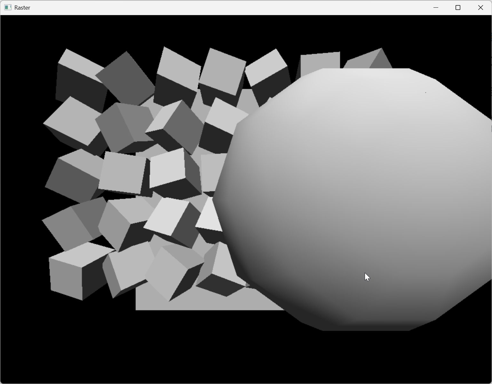

# C++ 软件光栅化器

[English](README.md) · [简体中文](README.zh-CN.md)

一个 Windows C++ 渲染演示：在 CPU 上把三维三角形转换成带光照的图像，展示变换、裁剪、三角形填充、光照与深度缓冲之间的关系，并包含按屏幕行分片的多线程渲染路径。



[主要实现](Rasterizer/raster.cpp) · [渲染类](Rasterizer) · [来源与署名](THIRD_PARTY_NOTICES.md)

## 主要功能

- 生成立方体与球体场景，进行相机和透视变换。
- 在支持的深度范围内裁剪三角形，填充屏幕像素。
- 用 Z-buffer 判断前后遮挡关系。
- 计算表面光照，并在演示场景中旋转物体。
- 通过线程池把屏幕行分配给多个任务，同时保留串行渲染路径。

## 我的实现与项目背景

这是我的 WM9M4 Games Engineering 课程作业中的光栅化器部分。课程实现把场景构建、变换、三角形处理、着色、可见性与线程池渲染连接成了一个可观察的演示。项目基于课程的 `GamesEngineeringBase` 框架与相关教学材料，框架不属于我独立编写的代码。

原提交同时包含光栅化器与聊天室，本仓库只提取渲染项目。原始版本记录在 [THIRD_PARTY_NOTICES.md](THIRD_PARTY_NOTICES.md) 中。源码名称、工程设置与解决方案的相对路径保持原样。

## 技术实现

| 技术／系统 | 用途 | 代码入口 |
| --- | --- | --- |
| C++ 与程序化网格 | 构建立方体、球体和动态场景 | [`raster.cpp`](Rasterizer/raster.cpp)、[`mesh.h`](Rasterizer/mesh.h) |
| 矩阵变换与裁剪 | 把世界空间三角形投影到图像 | [`matrix.h`](Rasterizer/matrix.h)、[`raster.cpp`](Rasterizer/raster.cpp) |
| 三角形填充与深度缓冲 | 计算像素覆盖和可见深度 | [`triangle.h`](Rasterizer/triangle.h)、[`zbuffer.h`](Rasterizer/zbuffer.h) |
| 光照 | 计算表面颜色 | [`light.h`](Rasterizer/light.h) |
| 线程池 | 调度不同屏幕行的渲染任务 | [`Tpool.h`](Rasterizer/Tpool.h) |
| 课程窗口框架 | 显示 CPU 渲染图像 | [`renderer.h`](Rasterizer/renderer.h)、[`GamesEngineeringBase.h`](Rasterizer/GamesEngineeringBase.h) |

## 构建与运行

需要 Windows x64、Visual Studio 2022 的 C++ 桌面开发工作负载、MSVC v143 工具集和 Windows SDK。

打开 `Rasterizer.sln`，选择 **Release / x64** 并构建。也可以在仓库根目录的 Visual Studio Developer PowerShell 中运行：

```powershell
msbuild .\Rasterizer.sln /m /p:Configuration=Release /p:Platform=x64
.\x64\Release\Rasterizer.exe
```

程序打开 `Raster` 窗口，运行 `raster.cpp` 中由 `funcnum` 选择的场景；默认是场景 2。按 **Escape** 退出。目前需要在源码中选择场景，没有场景菜单。可选的 `sceneTest()` 包含键盘平移控制，但不是默认场景。

## 状态与限制

拆分工程于 2026 年 10 月 11 日通过 **Release x64** 构建，并检查了实际立方体／球体渲染画面；上图来自这次运行。原有编译警告仍存在。项目定位为课程渲染演示，不是完整游戏或通用图形引擎。

原场景循环同时保留串行与多线程调用；这不代表已经证明性能提升。本仓库不宣称新的基准测试或加速结果，保留原实现以便读者检查这些设计选择。

## 来源与署名

`GamesEngineeringBase.h` 保留课程团队的 MIT 声明。没有为整个组合项目新增许可证。课程来源与再分发边界见 [THIRD_PARTY_NOTICES.md](THIRD_PARTY_NOTICES.md)。
